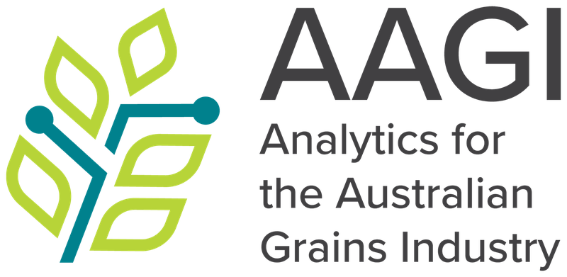

ANU-AAGI is a research collaboration with the Strategic Partners of the Analytics for the Australian Grains Industry (AAGI) funded by the Grains Research Development Coorperation (GRDC). ANU officially joined AAGI at the end of 2024.

If you are part of ANU and would like to be involved (now or in future), please reach out to the [ANU lead](/contact/). We are interested in consolidating analytical expertise to solve agricultural problems across ANU.

## Acknowledgement

We gratefully acknowledge funding from the Grains Research and Development Corporation (GRDC) through the Analytics for the Australian Grains Industry (AAGI) initiative.

{height="4em"} &emsp; {height="4em"}

We also gratefully acknowledge sponsorship by [Zulip](https://zulip.com/) for cloud hosting of our team chat.

{height="2em"}

We are also grateful for technology and tools that enable our work. These include:

- {height="2em"} [Quarto](https://quarto.org/), which we used to develop this website

- {height="2em"} GitHub, which we use to host this website and also use extensively for our projects

- {height="2em"} R, which we use for our statistical analysis.

